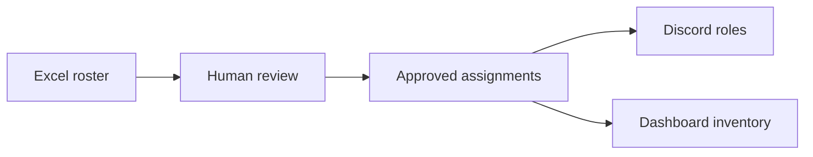

# Claw and Order implementation and setup

Prepared for Matthew and the Cyberlabs administrator

**Current deployment update (November 5):** Hermes replaces the former execution agent; retain the existing Discord server/webhooks. Read HERMES-DISCORD-ROSTER-READINESS.md first for verified code assumptions and the current roster/access/coverage process. Cloudflare Workers + D1 hosts the dashboard/API; the Python scoring/enrollment service remains separate. Earlier dashboard PostgreSQL/file-policy instructions apply to the legacy deployment, not the deployed Worker. Neither the installed Hermes telemetry format nor live Cyberlabs enrollment has been independently verified.

## What we are delivering

We are extending the existing Operation Open Claw lab with an auditable student-to-Discord enrollment pipeline and a live team topology dashboard. The owner-confirmed Kali webhook/script connection remains in place; the reporter/backend path is an implemented option to verify before any cutover. Two classes can use the same system, students can belong to both classes, and additional teams/classes can be configured without a fixed team count in the code.

For semester onboarding, we need the Excel rosters and the chosen Discord configuration. Bot setup includes its token and server/role/channel IDs as well as permissions. Existing hosting, team network mappings and machine/reporting services must pass the short live pilot before we invite the classes.



## What Matthew needs from us

| Input | What to provide |
| --- | --- |
| Excel rosters | Use the supplied blank template or provide an explicit column map. Include stable student, term and class IDs. Teams and responsibilities may be blank. |
| Selected Discord | Retain the existing server; confirm its server ID, a valid student invite, and hidden-channel access with an authorized administrator. |
| Discord posting hooks | Preserve existing Kali hooks. Supply new/replacement hook URLs privately, labeled by producer, team/class and destination. Backend alert hooks are a separate purpose. |
| Existing telemetry source | Record the Kali script, message format, channel ID, webhook ID and exact team IDs. The dashboard reader needs its own token and explicit source mapping. |
| Enrollment bot setup | A separate bot application's token, class/team/responsibility role IDs and private channel IDs; grant only the documented permissions. |
| Faculty role decisions | Supply approved responsibility definitions/mappings when available. Leave responsibility blank until then; class/team enrollment can proceed. |

Includes source, blank templates, administrator/Hermes guides, recovery plans and audit evidence. Cyberlabs installs hosting and source configuration; port 5173 is a local preview.

<!-- pagebreak -->

## Excel and Discord setup

### One row per student per term and class

| Column | Meaning | Required |
| --- | --- | --- |
| student_id | Stable school/roster identifier stored as text | Yes |
| email | College email used for private invitation delivery | Yes |
| display_name | Student name for restricted administration | Yes |
| term_id | Explicit semester identifier | Yes |
| class_id | Class identifier matching the selected policy | Yes |
| team_id | Existing Claw scoring-team ID; blank means awaiting placement | No |
| role_key | Faculty-approved responsibility key; blank is permitted | No |
| idea | Optional private student idea; never permission instructions | No |
| status | active or withdrawn; blank means active | No |

Use the Roster worksheet, plain values and text identifiers. The same student can have two rows for two classes with different teams. Omitted rows do not withdraw students. Existing spreadsheets with other headers need an explicit mapping; class, team and privilege are never guessed from free text. An email-and-team list alone needs the remaining required fields added.

### Keep the Discord jobs clear

| Connection | Permissions and configuration |
| --- | --- |
| Posting webhook | A Discord administrator creates the hook with Manage Webhooks. Existing Kali scripts post telemetry; backend hooks post alerts. Neither assigns student roles. |
| Enrollment bot | bot and applications.commands scopes; Manage Roles; inspection access to listed channels. No Administrator. Managed roles sit below the bot, have zero server permission bits, and use reviewed channel overrides. |
| Message reader | For existing [OCRT] webhook telemetry: separate reader bot token, channel/webhook/team source map, View Channel, Read Message History and Message Content intent. |

Use a dedicated enrollment bot so its slash-command registration and role authority do not interfere with any existing OpenClaw/telemetry bot. Keep staff/admin roles above it. Private team channels deny View Channel to everyone, allow the intended team and trusted staff, and must not be exposed by another managed class/team/responsibility role. The worker also checks the student's effective channel access.

<!-- pagebreak -->

## How we implement the rollout

| Step and owner | Action and evidence |
| --- | --- |
| 1 Cyberlabs administrator | Preserve the running lab and backups. Record backend/dashboard hosts, database access, existing Kali publishers/hooks, team IDs, policy and current service status. Verify reporter credentials only if adopting that route. Install the two repositories and repeatable migrations using the supplied deployment guide. |
| 2 Discord owner | Select the server, create/reuse approved roles/channels, provide the private alert hooks and separate enrollment bot token. Fill the policy with exact IDs and keep API/worker policy contents identical. |
| 3 Service operator | Run non-posting hook preflight and read-only bot permission preflight. Start the enrollment worker separately from the API. Configure the selected dashboard feed and its source map, plus the trusted machine-status producer. |
| 4 Faculty and Hermes planner | Preview the Excel import with requester, reason and ticket. Review the readable report, pending placements, before/after assignments and permission plan. Hermes uses only the separate planner credential. |
| 5 Human administrator | Review the authoritative server report and apply its exact digest with a recorded approver. Generate private invitations and use approved college mail merge, or the separately reviewed optional SMTP sender. |
| 6 Student and administrator | Student joins the selected server and privately runs /register with their single-use code. The worker applies approved roles, reads them back and checks listed private-channel access. Save the verification report and student history. |

### First checks

```sh
python -m backend.check_discord_webhooks
python -m backend.enrollment_bot --check
python -m backend.enrollment_cli status --out private/status-001.json
```

The checks above do not post test alerts or grant roles. A human-controlled live pilot must subsequently confirm delivery and channel access. Use the exact preview, apply, verify, change and rollback commands in system/backend/claw-and-order/docs/HUMAN-OPERATIONS.md; credentials are loaded privately, never pasted into reports.

If the original services are already deployed, validate and reuse them. Provision only new teams and preserve existing team tokens. If they are not deployed, the service/database/TLS steps remain necessary; supplying an Excel file and hooks cannot start a missing backend or reporter.

<!-- pagebreak -->

## Success criteria and failure actions

| Check | Success | If it fails |
| --- | --- | --- |
| Excel upload | Expected students/classes/teams match the reviewed source; an unassigned student remains unassigned | Correct the row/header/identity conflict and create a new preview. No partial enrollment import is accepted. |
| Student roles | A dual-class student has the intended role union and sees only their allowed team channels | Hold the affected rollout, inspect policy/hierarchy/member overrides, repair and review reconciliation. |
| Team transfer | Old managed team access is removed, new access is verified and the other class is preserved | Keep the job/history; repair Discord access or preview a targeted correction. Rollback refuses later conflicting edits. |
| Kali and dashboard | A controlled event through the selected feed has correct team/fields and original posting/event time, imports once and remains single after replay | Preserve publisher state, queues and cursors. Repair the formatter/source map/feed; avoid overlapping Discord/backend ingestion. |
| Discord alerts | One controlled event reaches only intended class destination(s), with a stored delivery receipt | Preserve the queue; correct routing or rotate a revoked hook with the same destination name. |
| Machine gallery | A real authenticated report changes the correct machine indicator; stale/missing reports degrade or remain unknown | Repair the trusted probe/report producer. Attack events and Discord messages alone do not establish machine health. |
| Recovery and scale | Production-sized restore and class-load/freshness targets in DEPLOYMENT.md pass with named owners | Hold full launch, preserve evidence and resolve the measured bottleneck. |

<!-- pagebreak -->

## Daily changes remain visible

The administrator can move a student, unassign a team, change a defined responsibility or withdraw one class enrollment through a new preview. Every approved change records requester, reason, ticket, approver, time, revision and before/after assignments. A student history report links the change to its execution evidence.

Reports distinguish waiting, blocked, verified and superseded. Saved/queued is not completed Discord delivery. Verification is a recorded observation with a timestamp, not continuous monitoring. Keep reports and exact-recipient invitation files in restricted institutional storage.

## Current handoff status

The code is checked locally and packaged with reproducible tests. The 94 backend tests pass. The PostgreSQL pipeline recheck explicitly uses the shipped Excel template, separate planner/human approval, a dual-class transfer and the actual reporter HTTP method. Dashboard tests, lint and build pass, including webhook/team authorization and replay-time checks. Discord and SMTP tests use replacements rather than real student accounts or messages. Live credentials, permissions and the first real pilot are Cyberlabs acceptance steps.

The audit records seven remaining moderate development-tool advisories; production dependency scans were clear at the audit. Proposed security CI gates are included as owner-action patches because the current GitHub credential cannot edit workflows. Existing functional CI remains active. No production database was cleared by this work.
