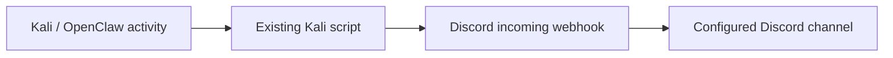
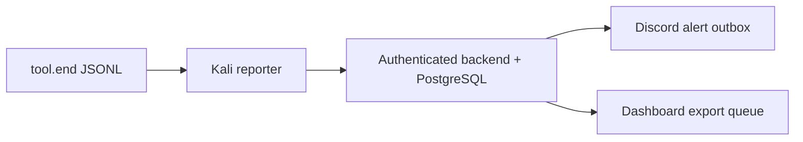

# Operation Open Claw infrastructure and Discord communication

Prepared for Matthew and the Cyberlabs administrator

## The existing Kali-to-Discord connection

The project owner confirmed that the existing connection uses a webhook or script on Kali. Preserve this working integration. A Kali-side publisher sends selected local telemetry to a Discord incoming webhook over outbound HTTPS. An incoming webhook posts to its configured channel using its URL/token; it does not assign student roles or read channel history.

The actual installed script, service name, trigger and payload were not supplied with these repositories. Matthew should inventory one representative VM and verify the transport before changing it. This document records the owner-confirmed connection; it does not claim that the live installation was inspected.



## Where the dashboard and student enrollment fit

| Component | Responsibility |
| --- | --- |
| Proxmox Cyberlab | Hosts Kali and target VMs. Cyberlabs controls the VM/network configuration. |
| Existing Kali publisher | Sends selected activity to Discord. Preserve its configuration and identify retry/log behavior onsite. |
| Dashboard message reader | Uses its own read-capable bot to import approved structured messages from mapped webhooks/channels. |
| Claw scoring backend | Implements an additional reporter/API/scoring route with persistent delivery queues; described on the next page. |
| New enrollment bot | Assigns approved student class/team/responsibility roles from the reviewed roster. Separate identity and authority. |

A posting hook alone cannot run the dashboard reader or enrollment worker. Those services need their own configured bot identities. Use one telemetry feed per logical dashboard event to prevent counting a direct Discord post and a backend-exported copy twice.

<!-- pagebreak -->

## How existing webhook messages reach the dashboard

The current dashboard reader accepts plain message content in this exact contract:

```text
[OCRT] ClassA_01 | Nmap | 10.50.1.100 | SUCCESS | Summary
```

The team ID must match the scoring/roster/topology inventory. The target above is an example for an authorized lab operation, not a production address. Free-form messages and embeds are not automatically parsed. If the installed script uses another shape, review a formatter or use the reporter route below before enabling dashboard import.

Set ALLOWED_CHANNELS and DISCORD_SOURCE_POLICY_FILE. Its version-1 JSON lists exact channel_id, webhook_id and permitted team_ids. Use the dashboard's config/discord-sources.example.json. These IDs are metadata, not the secret webhook URL/token. Every allowed channel needs a mapping. Only a mapped webhook can claim its listed teams; user messages, unknown hooks and cross-team claims are rejected and recorded.

Accepted messages use Discord's creation time, retain their message ID for deduplication and advance a durable cursor after storage. Replay preserves posting time; it cannot prove the tool's execution time. Fresh semester installations start at the channel head by default, preserving old channel history without importing last year's events. Decide any backfill before the first connection.

## Implemented reporter/backend route

The original architecture and repository also implement this separate route:



reporter.py reads the configured telemetry log, normalizes a tool.end record and posts to /api/events using a team credential. The backend validates target/phase/team, stores the event and scores milestones. Curated alerts go through an isolated Discord sender; scored events go through a store-before-ack dashboard export. reporter.py itself has no Discord posting client.

This route was rehearsed locally, not verified as the current Cyberlabs transport. Keep the existing publisher until a controlled pilot establishes the intended source. Outgoing milestone alerts are not the [OCRT] telemetry contract.

<!-- pagebreak -->

## Network and credential boundaries

The reviewed Proxmox student guide describes institutional VPN access and the Proxmox portal at pve.cyberlab.csusb.edu using the Cyberlab realm and institutional sign-in. This is the console/access route; it is separate from a Kali publisher's outbound Discord request.

The original architecture describes a management network for the central backend/database and an Ollama model VM. Confirm actual VLANs, routing and model endpoints against the installed inventory. Historical playbook addresses and the reporter template's 10.50.0.1:8000 are examples, not current production inventory.

| Origin to destination | Required connection and credential scope |
| --- | --- |
| Remote operator to lab | Institutional VPN and Proxmox HTTPS under Cyberlabs policy |
| Existing Kali script to Discord | Outbound HTTPS, normally port 443; limited posting webhook URL for its destination |
| Optional Kali reporter to backend | Configured HTTPS API origin and per-team bearer credential |
| Kali/OpenClaw to model service | Configured internal model API if deployed; confirm its actual host and port |
| Backend sender to Discord | Outbound HTTPS; alert hook/legacy bot credentials remain on the backend |
| Reader/enrollment bot to Discord | Outbound HTTPS and secure Gateway WebSocket; separate bot tokens on service hosts |
| Dashboard to backend | HTTPS export/acknowledgement with a distinct export-only credential |
| Backend and worker to PostgreSQL | Private database connection, verified TLS for remote production hosts |

Existing direct publishers need their limited posting hooks on Kali. A student or intruder who obtains one can post as that mapped source; the channel/team binding limits its dashboard scope but does not attest truthful tool execution. Prefer one hook per team and rotate exposed URLs. Keep enrollment administrator bot tokens, planner/admin API secrets and the shared dashboard write key off student-controlled VMs.

## Machine status is a separate observation

Trusted staff probes/integrations send authenticated POST /api/machines/heartbeat observations to the dashboard. A Discord message does not establish machine health. A reporter heartbeat only proves reporter liveness. Inventory machines without observations remain unknown; fresh reports age to degraded/offline according to the documented rules. Matthew must provide or verify this trusted monitoring integration for meaningful live machine indicators.

<!-- pagebreak -->

## Verify and preserve the installed connection

| Check | Evidence and success outcome | If it fails |
| --- | --- | --- |
| Inventory | Record VM/team, script/service, trigger, log path, hook ID/channel and expected payload; never record URL tokens | Preserve existing files and request the missing configuration from the operator |
| Controlled event | One authorized operation produces the expected local record and one correctly attributed Discord post | Inspect local errors, DNS/HTTPS reachability, hook revocation and rate-limit handling |
| Dashboard import | Mapped hook and team accepted once; wrong team/user post rejected; original posting time retained | Repair the formatter/source map and review rejected records; repost only the corrected test event |
| Restart/outage | Pending work/cursors survive and replay does not duplicate accepted dashboard records | Preserve state; repair the failed link. Existing script retry guarantees must be measured onsite |
| Health | A trusted report changes the intended machine card; a missing/stale source remains unknown or ages visibly | Repair the monitoring source; do not substitute activity counts for health |

## Controlled cutover and fallback

1. Back up the existing script/configuration privately. Record its publisher/channel/team mapping and current dashboard cursor before changing routing.
2. Pilot one team with the selected feed. If adopting the reporter route, confirm its actual tool.end producer, backend/team credentials, retry state, alert receipt and dashboard acknowledgement.
3. Set a documented cutover boundary and stop overlapping dashboard ingestion for those logical events. Discord and backend source IDs differ and cannot deduplicate each other. Parallel Discord posts may also confuse operators.
4. Compare source events and dashboard records, then restart/replay in staging. Expand after the operator accepts the evidence.
5. On failure, preserve both queues and restore the prior routing from the recorded boundary. Review already-imported events before resuming so rollback does not create a second copy. Leave the working Kali connection available until acceptance.

<!-- pagebreak -->

## Evidence and limits

- Current direct transport: project owner confirmation, November 3, 2026. Installed scripts/endpoints/payloads still require onsite inspection.
- Implemented alternative: reporter/reporter.py, backend event/Discord workers and dashboard backend-sync.js; original definitive architecture is a design reference, not proof of installation.
- Network/access context: reviewed Proxmox student guide, page 8, and historical Dogpark network/model appendices. No credentials or attack playbook copied into this delivery.
- Official Discord webhook/Gateway behavior and source details are listed in guides/SOURCES.md. No native OpenClaw Discord adapter is asserted to be installed.

## Installed inventory - complete privately

Use this record for one representative publisher, then expand per team. Keep completed records in restricted institutional storage. Enter secret-store references only; never paste posting URLs/tokens, bot tokens or raw student activity into the report.

| Field | Matthew or delegated operator records |
| --- | --- |
| Operator, inventory date and change reference | Pending onsite verification |
| Kali VM, class and exact scoring-team ID | Pending onsite verification |
| Script/service path, version and trigger | Pending onsite verification |
| Input source, observed message format and formatter | Pending onsite verification |
| Discord server, channel ID and webhook ID | Pending; IDs only |
| Posting URL secret-store reference | Pending; no secret value |
| Log, retry buffer, cursor and restart behavior | Pending observed evidence |
| Selected dashboard feed and source policy revision | Pending operator selection |
| Trusted machine-monitoring source and owner | Pending onsite verification |
| Pilot event IDs, timestamps and acceptance | Pending controlled pilot |

The full inventory template and source references also remain editable in guides/SOURCES.md. Record the cutover boundary and fallback routing before changing an existing publisher.
