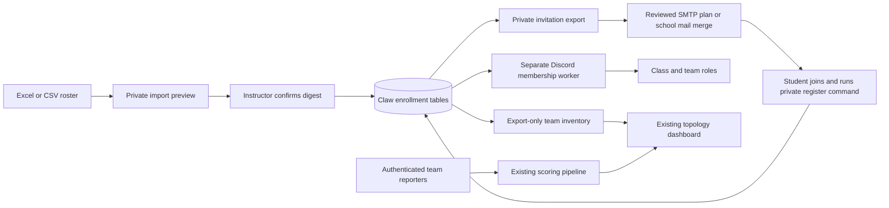

# Student enrollment operations

**November 5 update:** the owner selected the existing Discord server/webhooks and Hermes. Read HERMES-DISCORD-ROSTER-READINESS.md before importing these classes: reconcile Discord-only participants with approved school records, verify hidden-channel access and approve red-team coverage. This worker uses specific registered-member lookups, not a full Discord member census. The existing private registration works for students already in the server; they need not leave and rejoin.

For the current human-facing command sequence, change reports, targeted moves, named approvals and history, use [HUMAN-OPERATIONS.md](HUMAN-OPERATIONS.md). [HERMES-INSTRUCTIONS.md](HERMES-INSTRUCTIONS.md) defines the planner-only agent boundary. Change context and a human approver are required by the current API/CLI; regenerate older previews and update older operator scripts before this release.

## Architecture and boundaries



The database is authoritative for reviewed enrollment. Discord IDs identify accounts; email addresses are not used to guess Discord usernames. One `Student` can have several `Enrollment` records keyed by student, term and class. Each enrollment has an optional existing scoring team and responsibility key, a private idea field, and explicit active/withdrawn status.

The student-role catalog is pending faculty definitions; see ROLE-DEFINITIONS.md. Neither an agent nor a student idea can create a privileged role. Unknown role keys are rejected. A known but unapproved/unmapped responsibility blocks that student's role job until the mapping is approved and reconciled.

Team IDs are the existing `teams.id` used by event ingestion, token provisioning, exports, and topology. Provision real team network metadata with `scripts/provision_tokens.py` before using a team in a roster. The enrollment system never invents network addresses, rotates team tokens, or claims a machine is online.

## Configure the selected Discord

Copy `config/enrollment-policy.example.json` to an ignored private file. Replace every placeholder. `ENROLLMENT_POLICY_FILE` must point to the same contents for the API and enrollment worker.

- Select one `guild_id` and a Discord HTTPS invite belonging to that server.
- Give each term/class its own `discord_role_id`.
- Map each scoring team to one class, its unique team role, and every private text/voice channel that must be checked for isolation.
- Keep `role_definitions` and each class's `student_roles` empty until faculty supplies the duties. Student responsibility keys are shared logical keys; Discord responsibility role IDs are distinct per class.
- All managed role IDs must be distinct, below the bot's highest role, not integration-managed, and have zero server-level permissions. Do not grant Administrator to the enrollment bot.
- Deny View Channel to `@everyone` on private team channels. Allow the intended team role and trusted staff. Grant the bot View Channel for inspection. Other managed class, team and responsibility roles must not see that team's channels. Explicit overrides on child channels must also be listed and checked.

Invite the separate enrollment bot with `bot` and `applications.commands` scopes. It needs Manage Roles and access to inspect the listed channels. It requests Guilds intent only; it does not read chat or enumerate the whole student member list. It fetches a known member by the ID supplied in their interaction. Keep staff/admin roles above the bot.

Set `ENROLLMENT_DISCORD_BOT_TOKEN` only in the worker's secret store. Alert webhooks and the optional Discord telemetry reader keep their existing independent configuration. `ENROLLMENT_EMAIL_DOMAINS` can restrict imported addresses to the school's exact domains, separated by commas.

Use the owner-selected existing server for this launch and retain its history. If faculty later decides to switch servers, that is an explicit migration: preserve student IDs, stop the old worker, review the new mappings, reconfigure/restart the worker, reconcile approved enrollments, and ensure students join the new server. Old server memberships are not silently revoked. Previously linked accounts do not need another identity claim; issue a server invite through the school and reconcile after joining. Replacing a student's linked Discord account requires staff review; the registration command refuses to take over an existing link.

## Deploy

Python 3.12 is the container/CI baseline. The existing Node dashboard requires Node 20 and PostgreSQL in production. Run the API and enrollment worker as separate unprivileged processes against the same backend database. The dashboard uses its existing separate database. Native services are in `deploy/`; container examples mount policy read-only and keep credentials outside the image.

1. Back up both databases, policy and previous deployment artifacts. Test restore on a clone.
2. Install `requirements.lock`. Run `python -m backend.migrate` once with the deployment database owner; reruns are safe. New enrollment tables and the revision singleton must exist before either process starts.
3. Start the API with `APP_ENV=production`, PostgreSQL `DATABASE_URL`, `ADMIN_SECRET`, `EVENT_EXPORT_SECRET`, and the policy path. Protect `/api/admin/enrollment` behind staff network access/TLS. Student administration is never a public dashboard endpoint.
4. Run `python -m backend.enrollment_bot --check`. This logs in and verifies roles, private channels and invite identity without syncing commands or changing member roles.
5. Start `python -m backend.enrollment_bot`. It registers the private server-scoped `/register` command and processes durable jobs. Run one enrollment worker; keep the API's existing single-worker deployment for its alert sender/watchdog.
6. In the dashboard run `npm ci`, `npm run migrate`, and build/start the release. Existing `BACKEND_EXPORT_URL` and `BACKEND_EXPORT_SECRET` configure the new team feed too. No new student credential is sent to the dashboard.

The dashboard now requires the `enrollment_snapshots` table. Deploy the backend export before the dashboard poller. Class/team metadata polls every 30 seconds and the gallery every 15 seconds under normal operation. It retains the last durable snapshot if the source fails and marks its health degraded after errors or 120 seconds of stale sync. A policy referencing an unprovisioned scoring team returns 503 rather than silently hiding that team; provision it or correct the mapping before launch.

## Import a roster

Use `templates/roster.xlsx` (`Roster` sheet, row 1 headers) or UTF-8 `roster.csv`. Headers are `student_id,email,display_name,term_id,class_id,team_id,role_key,idea,status`. The first five fields are required. Store identifiers as text to preserve leading zeros. Keep the same student email/name in every row for that student. Duplicate/conflicting identities or duplicate class enrollments reject the batch. Student ideas are restricted text, never instructions.

Blank `team_id` means awaiting placement. Blank `role_key` means no responsibility assigned yet. Blank `status` means active; `withdrawn` is explicit. Omitting a row does not remove a student. Imports update only the rows reviewed in the batch. Limits are 10 MiB, 5,000 source rows and 40 columns; workbook expanded XML is capped at 32 MiB. Legacy `.xls`, formulas, macros-as-workflows, unknown columns and invalid IDs are not accepted. Export a clean values-only sheet when needed.

Load `ADMIN_SECRET` and `CLAW_BACKEND_URL` from a private environment file or secret store. HTTPS is required except for loopback development. From the backend `claw-and-order` directory:

```bash
python -m backend.enrollment_cli preview private/roster.xlsx --requested-by hermes --reason "Faculty approved semester import" --ticket CLAW-101 --out private/preview-001.json
# Review changes, role_preview and pending_role_definitions in that private file.
python -m backend.enrollment_cli apply private/preview-001.json --approved-by lab_admin --confirm-digest DIGEST_FROM_REVIEWED_FILE --out private/applied-001.json
python -m backend.enrollment_cli status --out private/status-001.json
python -m backend.enrollment_cli students --out private/student-status-001.json
```

For an existing spreadsheet layout, `--column-map private/columns.json` maps source header names to canonical names, or null to explicitly ignore a source column. No class, team or role is inferred from free text. A changed roster revision or policy hash, or a preview older than 24 hours, requires another preview. Applying the same batch again is idempotent. Exports paginate all students and stop if the roster revision changes mid-export.

## Invitations and registration

```bash
python -m backend.enrollment_cli invitations --student-id STUDENT_1 --student-id STUDENT_2 --ttl-hours 72 --out private/invites-001.json --format json
```

This creates no email. Deliver the private export through the school's approved mail-merge process, or use the optional SMTP stage below. Invite URLs and plaintext codes exist in these owner-only private files and eventual emails; the database stores only SHA-256 code hashes. Issuing a replacement revokes previous unused codes. Changing a student's roster email revokes outstanding codes. Codes are server-bound, single-use and expire after 1–168 hours (default 72). They cannot link one Discord account to two student identities. Keep completed rosters, previews, exports and mail receipts outside Git and public web roots.

The student joins the server, completes any Discord screening, and runs `/register` with their code. The command and response are private. The identity comes from Discord's interaction author. Approved class/team/responsibility roles are queued, not assigned from a claimed username or email. Students awaiting placement receive only their configured class access once processing completes. A roster update can assign their team later.

### Optional reviewed SMTP delivery

Set `ENROLLMENT_SMTP_HOST`, `ENROLLMENT_SMTP_FROM`, optional user/password, and `ENROLLMENT_SMTP_TLS=ssl` (default port 465) or `starttls` (default port 587). Certificate verification cannot be disabled. Restrict the institutional sender appropriately.

```bash
python -m backend.enrollment_mailer plan private/invites-001.json --out private/mail-plan-001.json
# Review recipients, sender, invite, expiry and body in the owner-only plan.
python -m backend.enrollment_mailer send private/mail-plan-001.json --confirm-digest REVIEWED_MAIL_DIGEST --run
```

Only `send` with the exact reviewed digest transmits mail. The sender rechecks each code, recipient and enrollment through the private API before connecting to SMTP. It records each accepted delivery, retries transport/transient failures, skips revoked/used/expired codes, and pauses on authentication, TLS/configuration or backend verification failure. Repair the dependency, then use `--resume` with the same digest. A lock prevents concurrent senders on the same plan. Do not run separate plans for the same invitation simultaneously. Regenerate codes/plans for permanently rejected recipients or expired invitations.

SMTP delivery is at least once: a crash after server acceptance but before the local receipt commits can repeat the invitation. The deterministic Message-ID and saved receipts aid reconciliation. Keep this private spool on persistent storage, back it up with access controls, and remove/retain it according to the school's data-retention policy. No SMTP credentials are written into the plan. A CSV mail-merge export is also supported; JSON avoids spreadsheet formula-prefix ambiguities.

## Private APIs and existing pipeline feed

| Endpoint under `/api/admin/enrollment` | Authentication | Purpose |
| --- | --- | --- |
| `GET /policy` | Admin secret | Review selected server and policy hash |
| `POST /imports`, `/imports/file` | Admin secret | JSON or bounded CSV/XLSX preview |
| `GET /imports/{id}` | Admin secret | Recover a private preview and digest |
| `POST /imports/{id}/apply` | Admin secret and digest | Apply the reviewed change set |
| `POST /imports/{id}/rollback-preview` | Admin secret | Prepare a reviewed restoration |
| `POST /reconcile/preview` | Admin secret | Requeue reviewed current assignments after repair |
| `POST /invitations`, `/invitations/check` | Admin secret | Issue/check private registration credentials |
| `GET /students`, `/audit`, `/status` | Admin secret | Staff reporting and aggregate operational status |
| `GET /teams/export` | Separate export secret | Class, term, team display name, member count and CIDR only |

All private responses, including authorization/validation failures, are marked no-store. Validation responses omit submitted values. Export credentials cannot read student records or apply imports. A separate planner credential can prepare/read changes but cannot apply them or access invitation credentials. The public health endpoint contains only aggregate enrollment state, worker readiness and queue counts. It degrades if a configured worker is missing/stale, uses another policy, has blocked jobs, or has pending/retry work older than 120 seconds. Awaiting registration is a normal state, not proof of a failed worker.

The durable role worker fetches current Discord membership, validates access, removes obsolete managed access before additions, changes one role at a time, and preserves unrelated roles. Approved grant intent is recorded in the same transaction as queueing, before any Discord operation; the managed-grant ledger therefore covers an addition accepted just before a connection loss or crash, including a role retired by a later policy. Network attempts are bounded to 30 seconds per job; retry resumes from actual Discord roles after partial success. Do not run a separate manual role synchronizer over the same managed roles.

## Recovery and acceptance

| Scenario | Success outcome | Failure/fallback |
| --- | --- | --- |
| Invalid spreadsheet or identity conflict | No enrollment mutation; staff gets specific row/field errors | Correct the source and create a new preview |
| Student in both classes | One identity, independent team/role per class | Stop affected assignments and repair the mapping; never merge by Discord display name |
| Unassigned student | Class access, no private team access, visible awaiting placement | Leave team blank until faculty approves placement |
| Responsibility not defined | Explicit pending/blocked reason; no guessed grants | Complete ROLE-DEFINITIONS.md, update policy, restart worker, review/apply reconciliation |
| Expired/reused/wrong-server code | No account binding or role change | Reissue an invitation through the restricted staff workflow |
| SMTP outage | Durable retry/paused state, no lost invitation plan | Repair service, verify pending recipients/codes, resume; reconcile possible acceptance-window duplicates |
| Discord outage/partial role update | Pending work survives restart and converges without replacing unrelated roles | Observe retry queue; do not delete jobs to hide a failure |
| Missing member | `awaiting_member`; retry after the student joins | Verify the selected server and invite |
| Discord 403, privileged role, or team channel leak | Assignment blocked and health degraded | Repair hierarchy/overwrites, run preflight, restart if policy changed, approve reconciliation |
| Incorrect roster application | A rollback preview shows the prior assignments; approved rollback reconciles access | Pause the worker while investigating; preserve audit and database before broader recovery |
| Dashboard source failure | Last durable inventory retained; health degraded, no fabricated students/machines | Repair export secret/network/database; poller recovers |
| Production promotion | Real two-class pilot passes isolation, registration, email, transfer, restart and recovery checks | Keep prior release/databases and hold the full-class launch |

Rollback is `python -m backend.enrollment_cli rollback --batch-id ORIGINAL_BATCH_ID --requested-by hermes --reason "Faculty requested correction of prior assignment" --ticket CLAW-107 --out private/rollback-preview.json`, followed by human review and normal apply/verify. It refuses later conflicting student changes. Newly introduced enrollments become withdrawn; student identities and audit history are retained. Pause the worker before changing server/policy or restoring a database. Restore database, policy and any email spool consistently; do not restore an old sender spool and blindly resend already accepted invitations.

Run `python -m pytest tests -q`, dashboard tests/lint/build, then the isolated two-database PostgreSQL rehearsal in `scripts/rehearse_enrollment.py`. It refuses databases without explicit rehearsal names and refuses a prepopulated backend; no live Discord/SMTP connection is used. Before launch, repeat the acceptance table with staff-controlled real accounts, expected class sizes, trusted machine reporters and a production-sized backup/restore/load test.

## Future optional agent

A Cyberlabs assistant can propose column mappings, highlight conflicts, or suggest teams from student ideas. Its output remains a draft roster for instructor review. The bot and worker use fixed schemas and allowlisted mappings; they do not execute spreadsheet text or give an LLM a Discord Administrator token. Institutional SSO can replace the email-code identity step later without changing stable student or scoring-team IDs.

References: [Discord role management](https://docs.discord.com/developers/resources/guild#add-guild-member-role), [permission hierarchy and overwrites](https://docs.discord.com/developers/topics/permissions), [private interaction responses](https://discordpy.readthedocs.io/en/stable/interactions/api.html).
